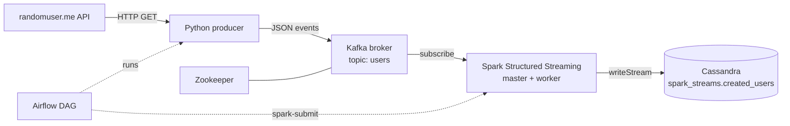

# Data Engineering Project

This project presents a comprehensive data streaming pipeline, integrating Python, Kafka, Spark Streaming, Docker, and Airflow. It enables streaming data from an API to Kafka, and subsequently to Cassandra using Spark Streaming. This project is designed to process, transmit, and analyze real-time data efficiently and at scale.



## Introduction

This repository leverages [Docker Compose](https://docs.docker.com/compose/) to set up the cluster infrastructure, which includes:

- Spark
- Kafka
- Cassandra
- Airflow
- Python

## Quick Start

1. Clone the repository:
    ```
    git clone https://github.com/itzzshut/spark-kafka-cassandra-pipeline.git
    cd spark-kafka-cassandra-pipeline
    ```

2. Build the Airflow image, which extends the official Airflow image with Java and the Spark provider so it can run Spark jobs (see the `Dockerfile`):
  ```
  docker build -t airspark:4.0 .
  ```

3. Launch the Docker Compose file:
  ```
  docker-compose up -d
  ```

4. Install the Cassandra driver inside the Spark master. Alternatively, you can extend the Spark Bitnami image to include the Cassandra driver.
  ```
  docker exec -it spark-master pip install cassandra-driver
  ```

5. Install the Kafka client on your machine to enable the use of KafkaProducer.
  ```
  pip install kafka-python requests
  ```

6. Finally, create the Kafka topic:
  ```
  docker exec -it broker kafka-topics --create --topic users --partitions 3 --replication-factor 1 --bootstrap-server localhost:9092
  ```

## Running the Application

After completing the setup steps, you are ready to start streaming.

1. Open the Airflow webserver UI and run the DAG `dag_for_spark_kafka_cassandra_streaming`.
  ```
  http://localhost:8080/login/
  ```
  -user: airflow
  -password: airflow

2. Alternatively, you can use the command line to run the application.
  - Use spark-submit to run the Spark job:
  ```
  docker exec -it spark-master bash
  cd app
  spark-submit --packages org.apache.spark:spark-sql-kafka-0-10_2.12:3.4.1,com.datastax.spark:spark-cassandra-connector_2.12:3.4.1 spark_streaming_consumer.py
  ```
  - In another terminal, run the producer (it streams for 2 minutes):
  ```
  cd app
  python kafka_streaming_producer.py
  ```

## Using "cqlsh" Cassandra Query Language Shell

You can use cqlsh to execute your SQL batch scripts on the data loaded into Cassandra.

- Enter the Cassandra container:
   ```
   docker exec -it cassandra bash
   ```
- then use cassandra query lang shell
   ```
   cqlsh
   ```
- start writing your queries, for example show the data
   ```
    SELECT * FROM spark_streams.created_users ;
   ```

## Maintainer

This project is maintained by Mariam Malik.

- GitHub: [itzzshut](https://github.com/itzzshut)
- LinkedIn: [Mariam Malik](https://www.linkedin.com/in/mariam-malik-308698259/)
- Email: [mariammalik5100@gmail.com](mailto:mariammalik5100@gmail.com)


